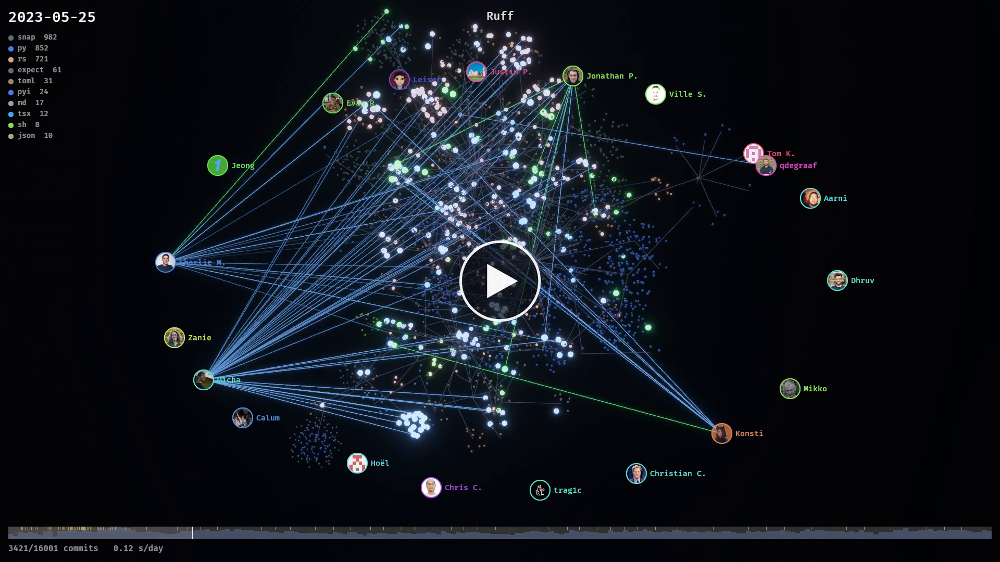

# Eridu

[](https://github.com/Galaktis/eridu/actions/workflows/ci.yml)
[](https://codecov.io/gh/Galaktis/eridu)
[](LICENSE)

*The Epic of your Repository* — a Git history visualizer.

Eridu replays a repository's history as a growing 3D tree: directories are branches,
files are glowing leaves colored by extension, and authors fly around lighting up the files they change.

[](https://www.youtube.com/watch?v=irlp_0FNRsA)

*[Ruff](https://github.com/astral-sh/ruff)'s history in May 2023 (17,900 commits, 950 contributors), recorded with `eridu --record`.*

▶ Watch it whole: **[The Epic of Ruff](https://www.youtube.com/watch?v=irlp_0FNRsA)** (3 min) ·
**[The Epic of Bevy](https://www.youtube.com/watch?v=f_gyS-hojL8)** (4 min).

Inspired by [Gource](https://gource.io) by Andrew Caudwell, the original software version control
visualizer: Eridu takes its idea into 3D. It shares no code with it.

An open-source project by Galaktis, built with [Bevy](https://bevy.org).
Website: **[eridu.galaktis.eu](https://eridu.galaktis.eu)**.

> **A word from the author.** I'm a Python developer, and Eridu is an experiment: how far can
> I go "vibe coding" a Rust project with an AI assistant, with only a few notions of Rust?
> A seasoned Rustacean would surely write some of this code differently. Feedback, issues and pull requests are very welcome — please be kind! 🙂

## Install

Download the archive for your system from the
[releases](https://github.com/Galaktis/eridu/releases), unpack it and run `eridu` from a terminal.
It needs `git` on the `PATH` (and [ffmpeg](https://ffmpeg.org) only to record videos).

- **Windows** (x86_64): `eridu.exe`. The binary isn't signed yet, so SmartScreen may warn about an
  unknown publisher the first time (More info → Run anyway).
- **macOS** (Apple silicon and Intel, one binary): it isn't signed yet either; run
  `xattr -d com.apple.quarantine eridu` once, or right-click it → Open.
- **Linux** (x86_64): needs a Vulkan driver (Mesa), on X11 or Wayland.

From the sources: `cargo build --release` (the first build takes a while: it compiles the
engine). On Linux, install `pkg-config libx11-dev libxkbcommon-dev libwayland-dev` first.

## Usage

```sh
eridu path/to/repo     # defaults to the current directory
eridu repoA repoB      # several repositories, one tree ("city") each
```

| Key | Action |
|---|---|
| Left drag | Rotate the camera |
| Mouse wheel, `+` / `-` | Zoom |
| `R` | Reset the camera |
| `C` | Camera: cinematic (directs its own shots when left alone, the default) or orbit |
| `V` | View: the tree, or the ziggurat (the whole history as stacked layers) |
| `B` | Side branches: their changes float above the tree until their merge |
| `Space` | Pause / resume |
| `↑` / `↓` | Faster / slower |
| `←` / `→` | Jump back / ahead 5 % |
| `Home` | Back to the start |
| `L` | File types legend |
| `F` | Follow the next active author |
| Click | An author: follow them. A file: focus it and show its history. Elsewhere: the whole tree |
| `N` | Author names |
| `Q` | Quality: low, high, ultra |
| `F3` | Performance stats |
| `F11` | Fullscreen |
| `H` | Help |
| `Esc` | Close the help / stop following / quit |

Beams and glows show what a commit did: green for added files, blue for modified ones, red for
deleted ones (which burst into sparks). Big commits sweep in file by file.

The bar at the bottom is the timeline: commits over time, with the repository's tags as ticks.
Hover it to see dates, and click (or drag and release) to jump anywhere. `--loop` starts over at the end.

Hover a file for its path and last change; hover an author to spotlight their work.
`--highlight-user 'jane*'` keeps someone always visible, `--follow-user 'jane*'` follows them.

Requires `git` on the `PATH`. `eridu --help` lists every option:

```sh
eridu --from 2023-01-01 --to v2.0 repo        # a date, a commit or a tag
eridu --start 40% repo                        # begin part-way through the history
eridu --exclude 'vendor/' --exclude '*.lock' --exclude-user 'dependabot*' repo
eridu --hide names,branches -s 0.5 repo       # 0.5 seconds of animation per day
```

Settings can live in a `eridu.toml` at the root of the visualized repository, loaded
automatically (`--config <file>` picks another one; flags override it). Keys are the flags' names:

```toml
seconds-per-day = 0.5
from = "2023-01-01"
exclude = ["vendor/", "*.lock"]
exclude-user = ["dependabot*"]
hide = ["branches"]
```

`--save-config <file>` writes the effective settings to a file.

## Other views

Both opt-in (the growing tree stays the main one):

- `--view ziggurat` (`V`): time as the vertical axis. Each period of the history is a layer of
  the files alive then, the present at the base and the past stacked above, the oldest files in
  the middle: you see at once when parts of the code were born, grew and died.
- `--branches` (`B`): branches are rebuilt from the commit graph. The tree follows the main
  line; a side branch's changes float above the files they change, and drop into the tree at
  the merge. Repositories that squash or rebase have nothing to show here.

## Video

```sh
eridu --record epic.mp4 repo                          # 1920x1080, 60 fps
eridu --record epic.mp4 --size 3840x2160 --fps 30 -s 0.5 repo
```

`--record` plays the history once into a video, then quits. Each frame advances the history by
exactly one frame's time however long it takes to draw, so the video is smooth even on a slow
machine (the window only shows a preview, its title the progress). The video is drawn at the
best quality, and has the HUD, the avatars and the timeline (`--hide` takes them out). It
ends on the final tree for 3 seconds.

Videos are encoded by [ffmpeg](https://ffmpeg.org) when it's on the `PATH`
(`winget install Gyan.FFmpeg` on Windows): H.264 for `.mp4`, `.mov` and `.mkv`, ffmpeg's own
choice for other extensions (`.webm`…). Without ffmpeg, or with a path without extension, it
writes a folder of PNG frames.

## Presentation

`--title`, `--logo <image>`, `--background <image>`, and `--avatar-dir <dir>` for
avatars named after GitHub logins, names or emails. `--quality low|high|ultra|auto` (default
`auto`, which steps down on slow machines).

## People

Authors are shown by first name only, never their last name (two people with the same first
name get an initial). The emails and spellings of one person are grouped together. For repos
hosted on GitHub, Eridu looks up each author's GitHub login, profile name and avatar in the
background, using `GITHUB_TOKEN`, `GH_TOKEN` or the `gh` CLI's token when available (needed
for private repos), and caches the answers; the status line counts them while they arrive,
and a video waits for all of them before it starts. `--people` prints who's who and quits; a `[people]`
table in the `eridu.toml` merges or renames people:

```toml
[people]
Ada = ["ada@home.org", "Ada L."]
```

## Support Eridu

Eridu is free and open source. If it brings your repository's story to life and you'd like to
help it grow, you can support its development on
[GitHub Sponsors](https://github.com/sponsors/Galaktis) or [Ko-fi](https://ko-fi.com/galaktis).
Starring the repository and sharing your videos helps too.

## Contributing

Bug reports, ideas and pull requests are welcome: see [CONTRIBUTING.md](CONTRIBUTING.md).

## License

[MIT](LICENSE) © 2026 Galaktis. The bundled Fira Mono font is under the
[SIL Open Font License](assets/FiraMono-LICENSE.txt).
